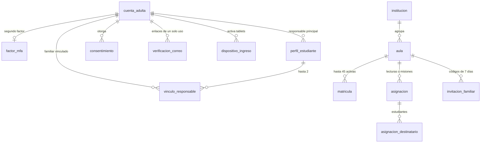
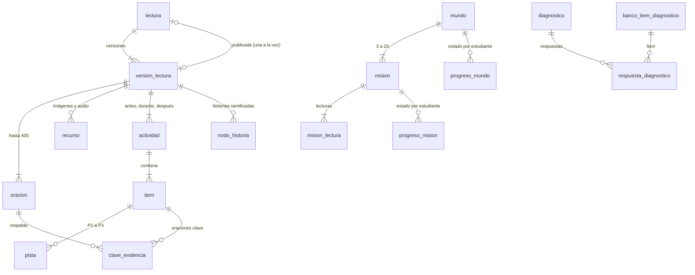
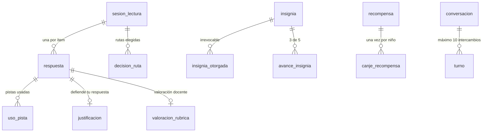

# Modelo de datos de LectoAventura (SRS §7)

La base PostgreSQL `lectoaventura` está organizada como pide el SRS: **un schema por bounded context**, tablas y columnas en `snake_case`, identificadores **UUID v7** y fechas `TIMESTAMPTZ`. Dentro de un schema hay llaves foráneas; entre schemas las referencias son solo por id, sin llave foránea, para poder separar módulos en servicios más adelante.

- Fuente de verdad: [`apps/api/prisma/schema.prisma`](../../apps/api/prisma/schema.prisma).
- Migración que creó la estructura: [`20261019000000_estructura_completa_srs`](../../apps/api/prisma/migrations/20261019000000_estructura_completa_srs/migration.sql). Movió las 11 tablas del Módulo 1 a su schema **sin perder datos** y creó las demás.

| Schema | Módulo | Tablas | Estado |
| :--- | :--- | :--- | :--- |
| `iam` | 1 · Identidad, consentimiento y acceso | 10 | ✅ En uso (`vinculo_responsable` desde el Módulo 2) |
| `escuela` | 2 · Escuela (aulas y asignaciones) | 6 | ✅ En uso: `aula`, `matricula`, `asignacion`, `asignacion_destinatario` e `invitacion_familiar`; `institucion`, lista para el registro de instituciones (RF-076) |
| `contenido` | 3 · Biblioteca y gestión de contenido | 9 | ✅ En uso: las 9 tablas (lecturas, versiones, oraciones, recursos, actividades, ítems, pistas, evidencias y nodos de historia). Migración [`20261020000000_comentario_revision`](../../apps/api/prisma/migrations/20261020000000_comentario_revision/migration.sql) |
| `aventura` | 4 · Mapa, mundos y misiones | 5 | ✅ En uso: los 5 mundos cargados, misiones por edad con sus lecturas y el progreso de cada niño. Migración [`20261021000000_aventura_misiones_por_edad`](../../apps/api/prisma/migrations/20261021000000_aventura_misiones_por_edad/migration.sql) |
| `diagnostico` | 5 · Diagnóstico | 3 | ✅ En uso: banco de 80 ítems (formas A y B para las tres edades), retos y respuestas. Migración [`20261022000000_banco_diagnostico`](../../apps/api/prisma/migrations/20261022000000_banco_diagnostico/migration.sql) |
| `lectura` | 6 · Lectura interactiva | 6 | ✅ En uso: sesiones de lectura con sus respuestas, pistas, defensas, decisiones de las historias ramificadas y valoraciones docentes. Migración [`20261023000000_lectura_sesiones`](../../apps/api/prisma/migrations/20261023000000_lectura_sesiones/migration.sql) |
| `progreso` | 7 · Perfil lector y recomendaciones | 3 | ✅ En uso: maestría por habilidad (5 por estudiante), su historial y las recomendaciones vigentes. Migración [`20261024000000_progreso_perfil_lector`](../../apps/api/prisma/migrations/20261024000000_progreso_perfil_lector/migration.sql) |
| `gamificacion` | 8 · Gamificación | 10 | ✅ En uso: libro de puntos, insignias (9 en el catálogo) con su avance, racha, reto del día, recompensas (10) y canjes; los parámetros versionados. Migración [`20261025000000_gamificacion_logros`](../../apps/api/prisma/migrations/20261025000000_gamificacion_logros/migration.sql), que agrega 4 tablas al SRS: `evento_aplicado`, `avance_insignia`, `recompensa` y `canje_recompensa` |
| `asistente` | 11 · Asistente inteligente | 2 | Lista |
| `admin` | 12 · Administración | 2 | ✅ En uso: `outbox_evento` y `auditoria` (vinculación familiar, invitaciones y tarjetas; envío a revisión, publicación, rechazo, versión nueva y archivo de lecturas; misiones creadas, editadas y reordenadas; el resto de RF-077 llega con el Módulo 12) |
| `reporting` | 9 y 10 · Seguimiento docente y familiar | 2 vistas materializadas | Lista |

**Total: 56 tablas (52 del SRS + 4 del Módulo 8) y 2 vistas de reportes.** La tabla `public._prisma_migrations` guarda el historial de migraciones: no se toca.

## Cómo verlas en pgAdmin

1. **Servers → PostgreSQL 16 → Databases → `lectoaventura` → Schemas**: verás los 11 schemas.
2. Abre cualquiera, por ejemplo **`iam` → Tables**, y luego clic derecho en una tabla → **View/Edit Data → All Rows**.
3. Las vistas de reportes están en **`reporting` → Materialized Views**.
4. Desde la consola (PSQL o Query Tool), el nombre lleva el schema delante:

   ```sql
   SELECT nombre, email, rol, estado FROM iam.cuenta_adulta;
   SELECT numero, nombre, habilidades_foco FROM aventura.mundo ORDER BY numero;
   ```

## Diagramas por módulo

### IAM y Escuela



`refresh_token`, `refresh_token_usado` y `exportacion` (IAM) no tienen llaves foráneas: guardan sesiones, huellas de tokens rotados y descargas temporales.

### Contenido, Aventura y Diagnóstico



### Lectura, Progreso, Gamificación y Asistente



`maestria_habilidad`, `historial_maestria`, `recomendacion`, `asiento_puntos`, `insignia_otorgada`, `avance_insignia`, `racha`, `reto_diario`, `evento_aplicado` y `canje_recompensa` se relacionan con el estudiante por su id (otro schema), sin llave foránea.

## Reglas del negocio dentro de la base

El dominio valida cada regla primero. La base es una segunda barrera: impide datos imposibles aunque alguien escriba con otra herramienta.

- **Restricciones `CHECK` con nombre `ck_*`**, por ejemplo:
  - roles y estados permitidos;
  - consentimiento institucional con aula (RN-01);
  - código de aula sin caracteres ambiguos (RF-014);
  - revisor distinto del autor (RN-15);
  - actividad "durante" con oración de anclaje (RF-024);
  - límites de imágenes y audio (RF-023);
  - puntos nunca negativos (RN-10) y cada asiento con un motivo conocido (`ck_asiento_motivo`, RF-056);
  - recompensas de tipo personaje o accesorio con costo positivo (RF-062);
  - máximo 10 intercambios del asistente (RF-074);
  - un solo diagnóstico inicial por estudiante.
- **Registros que solo se agregan:** `admin.auditoria` (RF-077), `gamificacion.asiento_puntos` (libro de puntos), `gamificacion.insignia_otorgada` (RN-13) y `gamificacion.canje_recompensa` (RF-062). Un *trigger* rechaza cualquier modificación o borrado.
- **Idempotencia:** un mismo evento no puede sumar puntos dos veces (`UNIQUE (evento_origen, motivo)`), y Gamificación aplica cada ítem, lectura, subida de nivel o mundo una sola vez (`evento_aplicado`, llave `(tipo, origen_id)`).

## Datos de catálogo cargados por la migración

- `aventura.mundo`: los 5 mundos del SRS con sus habilidades foco:
  1. Explorador: LIT y VOC.
  2. Detective: INF y VOC.
  3. Investigador: LIT e INF.
  4. Crítico: CRI y ARG.
  5. Maestro de la Lectura: las 5.
- `gamificacion.parametro_gamificacion` versión 1: la tabla de puntos de RN-11, el anti-*farming* de RN-12, el umbral de nivel de RF-057 y las palabras mínimas de RN-19.
- `gamificacion.insignia` (Módulo 8): 9 insignias con su regla en `regla` (JSON):
  - Primera lectura (1 lectura terminada).
  - Detective de Evidencias (5 evidencias correctas, UAT-03).
  - Maestro de las Inferencias (nivel Destacado declarado en INF).
  - Lector Perseverante (7 días de racha).
  - Una de rango por cada mundo completado (Explorador, Detective, Investigador, Crítico y Maestro de la Lectura).
- `gamificacion.recompensa` (Módulo 8): 5 accesorios (lupa, gorra, chullo, capa y corona) y 5 personajes (llama, cóndor, oso de anteojos, colibrí y dragón), de 5 a 60 monedas.

## Reportes

`reporting.mv_desempeno_aula` (aula × habilidad, con la distribución por nivel CNEB) y `reporting.mv_actividad_semanal` (estudiante × semana de Lima). Se actualizan con `SELECT reporting.refrescar_vistas();`, sin bloquear las lecturas. El SRS pide refrescarlas cada 5 minutos: lo hará el *worker* de reportes del Módulo 9.

## Equivalencias y decisiones

| SRS §7 | Implementado | Motivo |
| :--- | :--- | :--- |
| `iam.dispositivo_familiar` | `iam.dispositivo_ingreso` | CR-01: la tablet puede ser de una familia o de un aula |
| `iam.refresh_token` | `iam.refresh_token` + `iam.refresh_token_usado` | Detección de reutilización de tokens (ADR-005) |
| — | `iam.verificacion_correo`, `iam.exportacion` | Enlaces de un solo uso (RF-002, RF-004) y descargas de datos (RF-012) |
| `iam.vinculo_responsable` | Solo familiares **adicionales** | El responsable principal ya está en `perfil_estudiante.cuenta_responsable_id` (exactamente uno) |
| `escuela.aula.institucion_id` | Columna nueva y opcional | Se completará al registrar instituciones (RF-076, Módulo 12); hoy el aula guarda el nombre de la institución |
| `escuela.asignacion.estado` | Se guarda y se actualiza al consultar | Las asignaciones pasan de PROGRAMADA a ACTIVA y a VENCIDA por el paso del tiempo (hora de Lima): al listarlas, la API guarda el estado vigente; CERRADA lo pone la docente o el archivo del aula |
| `escuela.invitacion_familiar.hash_codigo` | Huella SHA-256 del código | El código de 8 caracteres se muestra una sola vez a la docente; el canje marca `usada_en` con una sentencia condicional, así que dos canjes simultáneos no pueden usarlo dos veces |
| `GET /aulas/{id}/tarjetas-acceso.pdf` (SRS §7) | `POST /aulas/{id}/tarjetas-acceso.pdf` | Generar tarjetas asigna PIN nuevos; un GET podría dispararse solo (vista previa de enlaces, reintentos) e invalidar tarjetas ya entregadas |
| `admin.auditoria` particionada por mes | Tabla normal con índice por fecha | La herramienta de migraciones (Prisma) aún no gestiona tablas particionadas; se particionará cuando el volumen lo pida (riesgo documentado en el SRS) |
| — | `contenido.version_lectura.comentario_revision` | RF-026 pide que el revisor devuelva la lectura "con comentarios" y el SRS no tenía dónde guardarlos. Guarda el motivo del último rechazo y se limpia al volver a enviar |
| Versiones de una lectura (RF-027) | Una versión que no está en borrador **no se modifica** | Editar una lectura publicada crea la versión N+1 (copia con ids propios de oraciones, actividades y recursos). La publicada sigue en la biblioteca hasta que se aprueba la nueva; entonces la anterior pasa a ARCHIVADA. `lectura.version_publicada_id` apunta siempre a una sola |
| `contenido.recurso` en almacenamiento de objetos (S3, SAD) | `clave_almacen` en una carpeta local (`ALMACEN_DIR`, por defecto `apps/api/almacen/`, fuera de Git) | Mismo contrato que S3: el editor pide una **URL firmada** de 10 minutos (HMAC-SHA256 con separación de dominio `subidas:`), sube el archivo y la API comprueba su firma real (WebP/AVIF, MP3/OGG/WebM/M4A) y el peso declarado. Cambiar a S3 es reemplazar un adaptador |
| Imágenes ≤ 200 KB en WebP/AVIF (RF-023) | El navegador convierte la imagen a WebP antes de subirla | Sin dependencias nuevas en el servidor; la API rechaza cualquier archivo que no sea WebP/AVIF de verdad |
| Peso de la lectura ≤ 1,5 MB (RNF-006) | Se comprueba al enviar a revisión | Suma texto, actividades, historia y recursos; una lectura más pesada no puede publicarse |
| Nivel del estudiante en la biblioteca (RF-028) | Su rango de edad y su nivel ± 1 | Mientras no exista el perfil lector (Módulo 7), el nivel inicial sale de la edad: 6–7 → 1, 8–9 → 2, 10–12 → 3. El Módulo 7 lo reemplazará registrándose en el shared-kernel (`NIVEL_LECTOR`) |
| Cuentas EDITOR y REVISOR | Las crea el equipo, no el registro público | En desarrollo: `npm run cuenta:backoffice --workspace @lectoaventura/api -- --email … --nombre "…" --rol EDITOR`. La persona define su contraseña con el enlace de recuperación y la verificación en dos pasos se le exige al entrar. El alta desde la administración llega con el Módulo 12 |
| `aventura.mision` (Mundo — Misión 1 : 3..20) | Columna nueva `rango_edad` (R1, R2, R3) y orden por mundo **y edad** | El SRS no decía cómo combinar los 5 mundos con las 3 edades. Cada misión es para una edad y sus lecturas son de esa edad: un niño de 7 años y uno de 11 recorren los mismos mundos con lecturas de su edad. Hasta 20 misiones por mundo y edad; RN-09 pide 3 completadas para avanzar |
| Orden de las misiones | Restricción única **diferible** `(mundo_id, rango_edad, orden)` | Reordenar intercambia posiciones dentro de una transacción; la unicidad se comprueba al confirmar |
| — | `aventura.progreso_mundo.celebrado_en` | RF-031 pide una celebración visual al desbloquear: se guarda cuándo la vio el niño para mostrarla una sola vez |
| Invariante "un mundo no puede estar COMPLETADO si el anterior está BLOQUEADO" (SRS §6) | Dominio + `CHECK ck_progreso_mundo_fechas` | Primero los completados, a lo sumo un disponible y luego los bloqueados; las fechas acompañan al estado. Completar un mundo es una actualización condicional: dos eventos simultáneos no lo desbloquean dos veces |
| Posición inicial (RF-033) y diagnóstico obligatorio (RN-05) | Se aplica cuando exista el Módulo 5 | Aventura ya consulta el diagnóstico por un puerto del shared-kernel. Mientras el Módulo 5 no exista en la plataforma, todos empiezan en el mundo 1; cuando exista, un diagnóstico pendiente deja el mapa cerrado y uno finalizado con LIT y VOC ≥ 65 ubica al niño en el mundo 2 |
| Desbloqueo (RF-031, RN-09) y misiones completadas (RF-032) | Por eventos de los Módulos 6 y 7 | Aventura ya escucha `lectura.SesionLecturaFinalizada` y `progreso.MaestriaActualizada` y consulta la maestría y el avance por puertos del shared-kernel; hasta que esos módulos publiquen, el mapa no avanza solo. Lo ya leído cuenta al abrir un mundo nuevo, y una misión completada no retrocede |
| Autoría de misiones | Backoffice de misiones (EDITOR arma y ordena; REVISOR consulta) | El SRS define el catálogo de misiones pero no quién lo arma. Crear, editar y reordenar queda en `admin.auditoria` (RF-077). No se borran misiones en esta versión: podrían tener avance de los niños |
| Banco de ítems del diagnóstico (validado por el líder pedagógico, SRS Sprint 0) | Banco inicial cargado por migración desde [`banco-diagnostico.json`](../../apps/api/prisma/semillas/banco-diagnostico.json) | 16 lecturas breves con contexto peruano y una pregunta de opción por habilidad en cada una: R1 10 ítems, R2 y R3 15 por forma. Es un **borrador para su validación**; se cambia editando el JSON y regenerando la migración con `generar-banco-diagnostico.mjs`. La respuesta correcta se guarda como índice y nunca sale del servidor |
| `banco_item_diagnostico.contenido` | `{ orden, lectura: { clave, titulo, texto }, opciones }` y `respuesta_correcta = { indice }` | `CHECK` de forma A/B, del contenido y de que el índice exista; índice único de `orden` por edad y forma |
| Reevaluación con "ítems equivalentes" (RF-037) | Forma según el tipo y la secuencia | El inicial usa la forma A; las reevaluaciones alternan B, A, B… (misma estructura y dificultad), así se comparan habilidad por habilidad. No hace falta una columna: se deriva de `tipo` y `secuencia` |
| Estados NO_INICIADO → EN_CURSO → PAUSADO → FINALIZADO (RF-036) | Un solo reto sin terminar por estudiante | Índice único parcial `diagnostico_un_pendiente_por_estudiante`: al volver a entrar se reanuda el mismo, en la pregunta siguiente a la última respondida (se responden en orden) |
| Nivel inicial por habilidad (RF-035) | `diagnostico.resultado` con valor 0–100, nivel CNEB e ítems por habilidad | En el reto no hay pistas: cada ítem vale 1 o 0, ponderado por dificultad (RN-07: 0,8 + 0,1 × dificultad) y promediado. El nivel CNEB inicial se informa siempre; el "nivel declarado" de RN-08 (≥ 5 ítems) queda en null porque el reto tiene 2 o 3 ítems por habilidad. El perfil lector (Módulo 7) partirá de estos valores |
| Posición inicial en el mapa (RF-033) y RN-05 | Evento `diagnostico.DiagnosticoFinalizado` + puerto `DIAGNOSTICO_INICIAL` | Desde el Módulo 5, un niño nuevo hace su reto antes de ver el mapa; al terminarlo, Aventura lo ubica (LIT y VOC ≥ 65 → mundo 2). Quien ya tenía mapa antes del Módulo 5 lo conserva y ve su reto como pendiente |
| `lectura.sesion_lectura.lectura_id` | Columna nueva (además de `version_lectura_id`) | La sesión queda atada a su versión (RN-14: no cambia) pero se reanuda por lectura aunque se publique otra versión (RF-027, RF-046), y Aventura consulta el avance por lectura (RF-032) sin ir a Contenido |
| Una sesión sin terminar por lectura (RF-046) | Índice único parcial `sesion_lectura_una_activa_por_lectura` (estados INICIADA y EN_CURSO) | Al volver se reanuda la misma; tras 7 días sin actividad queda ABANDONADA y se puede empezar otra. Repetir una lectura terminada abre otra sesión con `es_repeticion` (RN-12) |
| Una respuesta por ítem por intento (SRS §7) | Una fila de `respuesta` por ítem y sesión; cada nuevo intento la actualiza | Guarda el último envío, sus pistas en `uso_pista` (P1–P3 y `EXPLICACION`) y el puntaje del ítem de RN-07 al cerrarse. `idempotency_key` es la clave del último envío: repetirlo devuelve el mismo resultado sin volver a corregir. Las cerradas quedan `ENVIADA`; las abiertas pasan a `PENDIENTE_REVISION` al terminar la lectura si el niño tiene docente, y a `VALORADA` con la rúbrica |
| Respuesta de cada modalidad (`respuesta.contenido`) | `{ indice }`, `{ indices }` (selección múltiple), `{ orden }`, `{ oraciones }` o `{ texto, porVoz }` | En ordenar se guardan las posiciones de la lista tal como se mostró (mezclada de forma estable por sesión e ítem), así la pantalla no revela el orden correcto. Lo dictado (RF-049) llega como texto; el audio nunca se envía |
| "Defiende tu respuesta" (RF-044) | `justificacion` de la respuesta original | La defensa es un paso más del guion (no se omite) y se asocia a la pregunta anterior; con selección guarda la opción elegida y su texto |
| Selección múltiple (RF-040) | `contenido.item.contenido.multiple` y `respuesta_correcta = { indices }` | El editor de actividades del Módulo 3 permite marcar 2 o más correctas (y no todas); las de una sola respuesta no cambian |
| Maestría por habilidad (RF-053, RN-07) | `maestria_habilidad` (5 filas por estudiante) con bloqueo optimista por `version` | Parte del reto inicial (valor e ítems de cada habilidad) y se actualiza con cada ítem cerrado de una lectura: EMA α = 0,3 del puntaje del ítem × (0,8 + 0,1 × dificultad) × 100, acotada a 0–100. Las respuestas abiertas cuentan al ser valoradas (RN-19). Si dos cambios llegan a la vez, el segundo se vuelve a calcular |
| "En la misma transacción que la respuesta" (RF-053) | En el mismo pedido, por evento | Lectura publica `ItemRespondido` y Progreso lo aplica en el mismo pedido del niño (manejador en proceso del outbox, SAD §6), así los módulos no comparten transacciones. Si fallara, el evento queda pendiente y se reintenta sin contar doble |
| `historial_maestria.origen` / `origen_id` | `DIAGNOSTICO`, `ITEM` (id de la respuesta) o `VALORACION` (id de la respuesta valorada) | Índice único parcial `historial_maestria_origen_unico`: cada reto, respuesta o valoración mueve cada habilidad una sola vez, aunque su evento se reintente |
| Nivel de lectura (biblioteca RF-028, recomendaciones RN-20) | Calculado, no guardado | El típico de su edad (R1 1, R2 2, R3 3), −1 si su maestría promedio está en inicio, +1 logrado, +2 destacado; entre 1 y 5. Sin nada medido, cada módulo usa el típico de su edad |
| Recomendaciones vigentes (RF-055, RN-20) | Se calculan al pedirlas y se guardan solo si cambian | Entre 1 y 3 (índice único parcial `recomendacion_vigente_por_prioridad`): la asignación docente primero, la lectura que sigue en su misión en curso y una de su habilidad más débil a su nivel; sin ninguna, una de refuerzo. Las anteriores quedan con `vigente = false` como historial |
| Saldo de puntos (RF-056, SRS §6) | Suma de `asiento_puntos` (no se guarda un total) | Cada asiento lleva su motivo: `ITEM_CORRECTO` 10, `CORRECTO_TRAS_PISTA` 6, `RESPUESTA_ABIERTA` 10 (RN-19: ≥ 5 palabras en 6–9 años, ≥ 10 en 10–12), `LECTURA_COMPLETADA` 20, `SUBIDA_NIVEL_CNEB` 50 (la primera vez que cada habilidad llega a cada nivel), `RETO_DEL_DIA` 15 y `RACHA_3/7/30` 10/30/100. Equivocarse no genera asiento (RN-10) |
| `asiento_puntos.evento_origen` | El id de lo que dio los puntos | La respuesta (ítems), la sesión (lectura completada), el reto del día, o un UUID determinista (versión 8) para lo que no tiene id propio: la subida de nivel (estudiante + habilidad + nivel) y la racha (estudiante + fecha) |
| Anti-*farming* (RN-12) | Al otorgar, dentro de la cuenta | Repetir una lectura terminada (`es_repeticion`) da el 25 % redondeado y no suma a las insignias de lecturas ni de evidencias. El tope de 300 puntos por día de Lima se respeta aunque lleguen muchos logros a la vez: cada estudiante tiene un candado (`pg_advisory_xact_lock`) durante la transacción que aplica un logro |
| Nivel lector (RF-057) | Calculado desde el saldo | El nivel n pide 100 × n × (n + 1) / 2 puntos (100, 300, 600, 1000…); con menos de 100, nivel 0. La base (100) se lee de la versión vigente de los parámetros |
| Insignias (RF-058, RN-13) | `insignia.regla` + `avance_insignia` | Las de conteo (lecturas, evidencias) guardan su avance hasta la meta; las de nivel, racha y rango se evalúan con su evento. Una insignia se otorga una sola vez (llave `(estudiante, insignia)`) y nunca se quita. El reto inicial ubica en el mapa pero no otorga rangos: se ganan completando el mundo (evento `aventura.MundoDesbloqueado`) |
| Racha (RF-061) | `racha` con `comodin_usado_semana` (el lunes de la semana) | Cuenta los días de Lima con una lectura terminada o el reto del día completado. Si pasa un día sin actividad, el comodín de la semana de ese día lo cubre una vez; si no, vuelve a 1. La racha visible es 0 cuando ya se cortó |
| Reto del día (RF-060, RN-18) | `reto_diario.contenido = { meta, avance, lectura }` | Uno por estudiante y fecha de Lima (`UNIQUE`), para la habilidad de menor maestría: responder bien 3 preguntas de esa habilidad (o una abierta con esfuerzo), unos 5 minutos. Sugiere la lectura más sencilla de su edad que la trabaja y aún no terminó. Completarlo da +15 y cuenta para la racha; el de un día anterior sin completar queda `VENCIDO` |
| Monedas de recompensa (RF-062) | Calculadas: ⌊puntos / 10⌋ − monedas gastadas en `canje_recompensa` | Canjear descuenta monedas, nunca puntos ni nivel. Cada recompensa se canjea una vez por niño (`UNIQUE (estudiante_id, recompensa_id)`), bajo el mismo candado por estudiante |
| Parámetros (RF-078) | `parametro_gamificacion`, la versión más alta vigente | Se leen en cada logro, así un cambio aplica solo a lo que ocurre después; un valor ausente o inválido toma el del SRS. La pantalla del administrador llega con el Módulo 12 |

## Respaldo

Antes de reorganizar la base se guardó un respaldo completo en `Documentos\LectoAventura-respaldos\lectoaventura-antes-estructura-2026-10-16.dump`, fuera del repositorio porque contiene datos personales. Se restaura con `pg_restore`.
