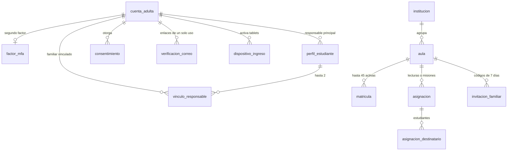
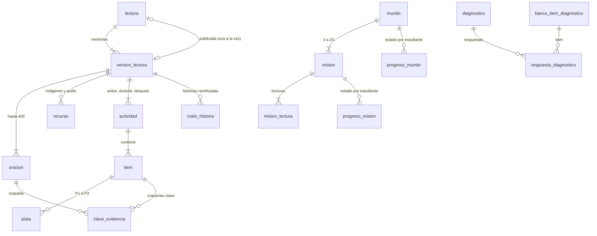
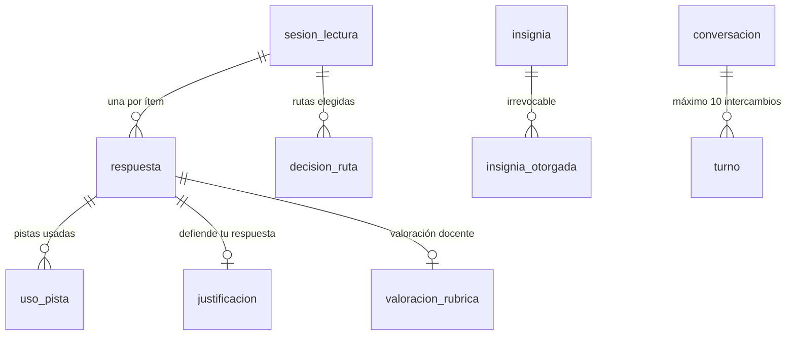

# Modelo de datos de LectoAventura (SRS §7)

La base PostgreSQL `lectoaventura` está organizada como pide el SRS: **un schema por bounded context**, tablas y columnas en `snake_case`, identificadores **UUID v7** y fechas `TIMESTAMPTZ`. Dentro de un schema hay llaves foráneas; entre schemas las referencias son solo por id, sin llave foránea, para poder separar módulos en servicios más adelante.

- Fuente de verdad: [`apps/api/prisma/schema.prisma`](../../apps/api/prisma/schema.prisma).
- Migración que creó la estructura: [`20261019000000_estructura_completa_srs`](../../apps/api/prisma/migrations/20261019000000_estructura_completa_srs/migration.sql). Movió las 11 tablas del Módulo 1 a su schema **sin perder datos** y creó las demás.

| Schema | Módulo | Tablas | Estado |
| :--- | :--- | :--- | :--- |
| `iam` | 1 · Identidad, consentimiento y acceso | 10 | ✅ En uso (`vinculo_responsable` desde el Módulo 2) |
| `escuela` | 2 · Escuela (aulas y asignaciones) | 6 | ✅ En uso: `aula`, `matricula`, `asignacion`, `asignacion_destinatario` e `invitacion_familiar`; `institucion`, lista para el registro de instituciones (RF-076) |
| `contenido` | 3 · Biblioteca y gestión de contenido | 9 | ✅ En uso: las 9 tablas (lecturas, versiones, oraciones, recursos, actividades, ítems, pistas, evidencias y nodos de historia). Migración [`20261020000000_comentario_revision`](../../apps/api/prisma/migrations/20261020000000_comentario_revision/migration.sql) |
| `aventura` | 4 · Mapa, mundos y misiones | 5 | Lista, con los 5 mundos cargados |
| `diagnostico` | 5 · Diagnóstico | 3 | Lista |
| `lectura` | 6 · Lectura interactiva | 6 | Lista |
| `progreso` | 7 · Perfil lector y recomendaciones | 3 | Lista |
| `gamificacion` | 8 · Gamificación | 6 | Lista, con los parámetros por defecto cargados |
| `asistente` | 11 · Asistente inteligente | 2 | Lista |
| `admin` | 12 · Administración | 2 | ✅ En uso: `outbox_evento` y `auditoria` (vinculación familiar, invitaciones y tarjetas; envío a revisión, publicación, rechazo, versión nueva y archivo de lecturas; el resto de RF-077 llega con el Módulo 12) |
| `reporting` | 9 y 10 · Seguimiento docente y familiar | 2 vistas materializadas | Lista |

**Total: 52 tablas y 2 vistas de reportes.** La tabla `public._prisma_migrations` guarda el historial de migraciones: no se toca.

## Cómo verlas en pgAdmin

1. **Servers → PostgreSQL 16 → Databases → `lectoaventura` → Schemas**: verás los 11 schemas.
2. Abre cualquiera, por ejemplo **`iam` → Tables**, y luego clic derecho en una tabla → **View/Edit Data → All Rows**.
3. Las vistas de reportes están en **`reporting` → Materialized Views**.
4. Desde la consola (PSQL o Query Tool), el nombre lleva el schema delante:

   ```sql
   SELECT nombre, email, rol, estado FROM iam.cuenta_adulta;
   SELECT numero, nombre, habilidades_foco FROM aventura.mundo ORDER BY numero;
   ```

## Diagramas por módulo

### IAM y Escuela



`refresh_token`, `refresh_token_usado` y `exportacion` (IAM) no tienen llaves foráneas: guardan sesiones, huellas de tokens rotados y descargas temporales.

### Contenido, Aventura y Diagnóstico



### Lectura, Progreso, Gamificación y Asistente



`maestria_habilidad`, `historial_maestria`, `recomendacion`, `asiento_puntos`, `racha`, `reto_diario` y `parametro_gamificacion` se relacionan con el estudiante por su id (otro schema), sin llave foránea.

## Reglas del negocio dentro de la base

El dominio valida cada regla primero. La base es una segunda barrera: impide datos imposibles aunque alguien escriba con otra herramienta.

- **Restricciones `CHECK` con nombre `ck_*`**, por ejemplo:
  - roles y estados permitidos;
  - consentimiento institucional con aula (RN-01);
  - código de aula sin caracteres ambiguos (RF-014);
  - revisor distinto del autor (RN-15);
  - actividad "durante" con oración de anclaje (RF-024);
  - límites de imágenes y audio (RF-023);
  - puntos nunca negativos (RN-10);
  - máximo 10 intercambios del asistente (RF-074);
  - un solo diagnóstico inicial por estudiante.
- **Registros que solo se agregan:** `admin.auditoria` (RF-077), `gamificacion.asiento_puntos` (libro de puntos) y `gamificacion.insignia_otorgada` (RN-13). Un *trigger* rechaza cualquier modificación o borrado.
- **Idempotencia:** un mismo evento no puede sumar puntos dos veces (`UNIQUE (evento_origen, motivo)`).

## Datos de catálogo cargados por la migración

- `aventura.mundo`: los 5 mundos del SRS con sus habilidades foco:
  1. Explorador: LIT y VOC.
  2. Detective: INF y VOC.
  3. Investigador: LIT e INF.
  4. Crítico: CRI y ARG.
  5. Maestro de la Lectura: las 5.
- `gamificacion.parametro_gamificacion` versión 1: la tabla de puntos de RN-11, el anti-*farming* de RN-12, el umbral de nivel de RF-057 y las palabras mínimas de RN-19.

## Reportes

`reporting.mv_desempeno_aula` (aula × habilidad, con la distribución por nivel CNEB) y `reporting.mv_actividad_semanal` (estudiante × semana de Lima). Se actualizan con `SELECT reporting.refrescar_vistas();`, sin bloquear las lecturas. El SRS pide refrescarlas cada 5 minutos: lo hará el *worker* de reportes del Módulo 9.

## Equivalencias y decisiones

| SRS §7 | Implementado | Motivo |
| :--- | :--- | :--- |
| `iam.dispositivo_familiar` | `iam.dispositivo_ingreso` | CR-01: la tablet puede ser de una familia o de un aula |
| `iam.refresh_token` | `iam.refresh_token` + `iam.refresh_token_usado` | Detección de reutilización de tokens (ADR-005) |
| — | `iam.verificacion_correo`, `iam.exportacion` | Enlaces de un solo uso (RF-002, RF-004) y descargas de datos (RF-012) |
| `iam.vinculo_responsable` | Solo familiares **adicionales** | El responsable principal ya está en `perfil_estudiante.cuenta_responsable_id` (exactamente uno) |
| `escuela.aula.institucion_id` | Columna nueva y opcional | Se completará al registrar instituciones (RF-076, Módulo 12); hoy el aula guarda el nombre de la institución |
| `escuela.asignacion.estado` | Se guarda y se actualiza al consultar | Las asignaciones pasan de PROGRAMADA a ACTIVA y a VENCIDA por el paso del tiempo (hora de Lima): al listarlas, la API guarda el estado vigente; CERRADA lo pone la docente o el archivo del aula |
| `escuela.invitacion_familiar.hash_codigo` | Huella SHA-256 del código | El código de 8 caracteres se muestra una sola vez a la docente; el canje marca `usada_en` con una sentencia condicional, así que dos canjes simultáneos no pueden usarlo dos veces |
| `GET /aulas/{id}/tarjetas-acceso.pdf` (SRS §7) | `POST /aulas/{id}/tarjetas-acceso.pdf` | Generar tarjetas asigna PIN nuevos; un GET podría dispararse solo (vista previa de enlaces, reintentos) e invalidar tarjetas ya entregadas |
| `admin.auditoria` particionada por mes | Tabla normal con índice por fecha | La herramienta de migraciones (Prisma) aún no gestiona tablas particionadas; se particionará cuando el volumen lo pida (riesgo documentado en el SRS) |
| — | `contenido.version_lectura.comentario_revision` | RF-026 pide que el revisor devuelva la lectura "con comentarios" y el SRS no tenía dónde guardarlos. Guarda el motivo del último rechazo y se limpia al volver a enviar |
| Versiones de una lectura (RF-027) | Una versión que no está en borrador **no se modifica** | Editar una lectura publicada crea la versión N+1 (copia con ids propios de oraciones, actividades y recursos). La publicada sigue en la biblioteca hasta que se aprueba la nueva; entonces la anterior pasa a ARCHIVADA. `lectura.version_publicada_id` apunta siempre a una sola |
| `contenido.recurso` en almacenamiento de objetos (S3, SAD) | `clave_almacen` en una carpeta local (`ALMACEN_DIR`, por defecto `apps/api/almacen/`, fuera de Git) | Mismo contrato que S3: el editor pide una **URL firmada** de 10 minutos (HMAC-SHA256 con separación de dominio `subidas:`), sube el archivo y la API comprueba su firma real (WebP/AVIF, MP3/OGG/WebM/M4A) y el peso declarado. Cambiar a S3 es reemplazar un adaptador |
| Imágenes ≤ 200 KB en WebP/AVIF (RF-023) | El navegador convierte la imagen a WebP antes de subirla | Sin dependencias nuevas en el servidor; la API rechaza cualquier archivo que no sea WebP/AVIF de verdad |
| Peso de la lectura ≤ 1,5 MB (RNF-006) | Se comprueba al enviar a revisión | Suma texto, actividades, historia y recursos; una lectura más pesada no puede publicarse |
| Nivel del estudiante en la biblioteca (RF-028) | Su rango de edad y su nivel ± 1 | Mientras no exista el perfil lector (Módulo 7), el nivel inicial sale de la edad: 6–7 → 1, 8–9 → 2, 10–12 → 3. El Módulo 7 lo reemplazará registrándose en el shared-kernel (`NIVEL_LECTOR`) |
| Cuentas EDITOR y REVISOR | Las crea el equipo, no el registro público | En desarrollo: `npm run cuenta:backoffice --workspace @lectoaventura/api -- --email … --nombre "…" --rol EDITOR`. La persona define su contraseña con el enlace de recuperación y la verificación en dos pasos se le exige al entrar. El alta desde la administración llega con el Módulo 12 |

## Respaldo

Antes de reorganizar la base se guardó un respaldo completo en `Documentos\LectoAventura-respaldos\lectoaventura-antes-estructura-2026-10-16.dump`, fuera del repositorio porque contiene datos personales. Se restaura con `pg_restore`.
