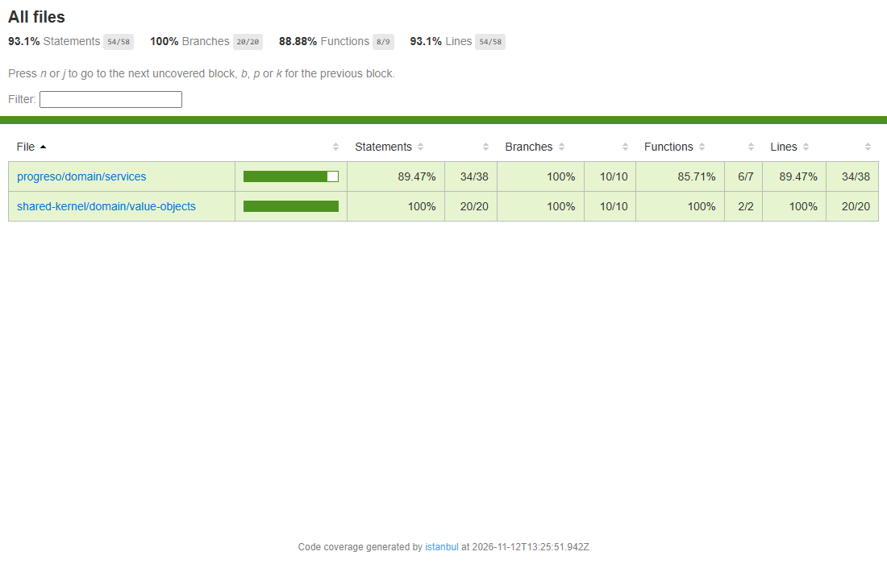
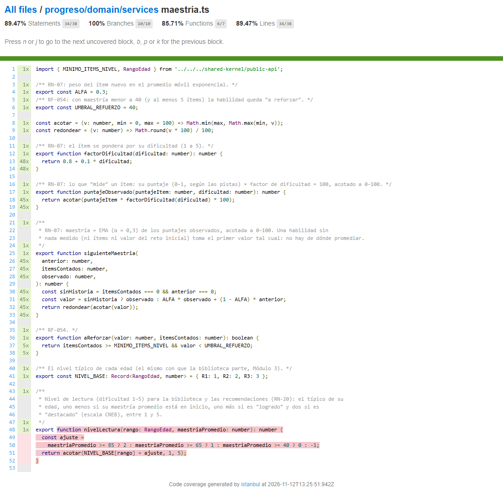
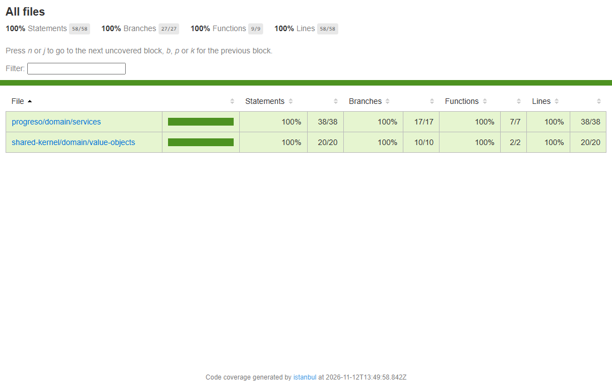
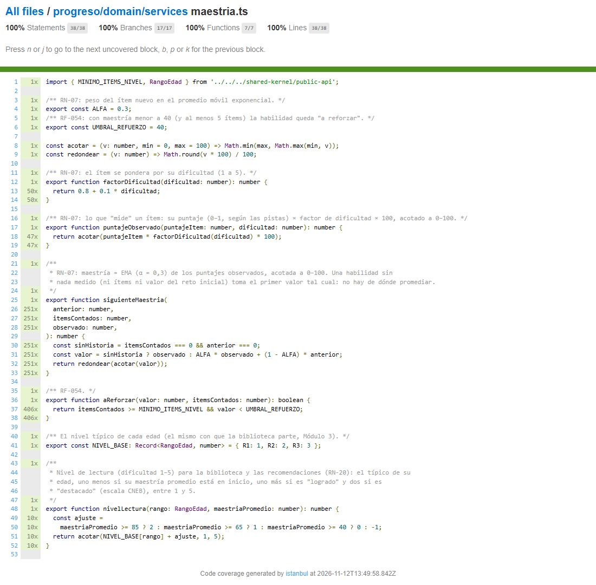

<!-- Generado con node docs/pruebas/construir.mjs desde 15-caja-negra-cobertura.plantilla.md. No editar a mano. -->
# Caja negra y cobertura al 100 %: maestría y nivel CNEB de LectoAventura (Semana 12, C7.I2)

Sesión 12: criterios de cobertura y pruebas de caja negra con IA. Los números salen de ejecuciones reales del 12 de noviembre de 2026, rama `semana-12-caja-negra`.

**Componente bajo prueba:**

| Archivo | Qué hace |
| :--- | :--- |
| `apps/api/src/modules/progreso/domain/services/maestria.ts` | Calcula la maestría de cada habilidad (RN-07), decide qué habilidades están "a reforzar" (RF-054) y el nivel de lectura (RN-20) |
| `apps/api/src/modules/shared-kernel/domain/value-objects/nivel-cneb.ts` | Escala CNEB C, B, A y AD, y el nivel "declarado" con 5 ítems (RN-08) |

**Por qué este componente:** es el equivalente del `CalificacionService` de la guía, porque convierte respuestas en una nota con tramos. De él depende lo que la docente y la familia ven del niño.

---

## Lista de cotejo (sección 8 de la guía)

| # | Punto | Estado | Dónde está la evidencia |
| :--- | :--- | :--- | :--- |
| 1 | Entorno configurado | ✅ Vitest 3.2 con `@vitest/coverage-v8`, ya instalados; sin dependencias nuevas | Sección 1 |
| 2 | Casos de caja negra documentados | ✅ 34 casos con partición de equivalencia y valores límite, diseñados solo con el SRS | Secciones 2 y 3 |
| 3 | Contraste con IA realizado | ✅ 12 escenarios propuestos: 5 aplican (4 nuevos y 1 que ya estaba) y 7 no | Sección 5 |
| 4 | Cobertura de sentencias al 100 % | ✅ 58 de 58 | Sección 6 |
| 5 | Cobertura de ramas y condiciones al 100 % | ✅ Ramas 27 de 27; condiciones 24 de 24 | Sección 6 |
| 6 | Captura y análisis del reporte | ✅ Reporte HTML, capturas e interpretación | Secciones 6 y 8 |

---

# 1. Entorno y comandos

No hubo que instalar nada: el proyecto ya tenía Vitest y `@vitest/coverage-v8`, que es la fila "React / Node / TS" de la tabla de la guía. Desde la carpeta `apps/api`:

```bash
npx vitest run test/unit/progreso/dominio/maestria-caja-negra.spec.ts
```

Cobertura de sentencias y ramas, con el reporte HTML en `apps/api/reports/caja-negra/final/index.html`:

```bash
npx vitest run test/unit/progreso/dominio/maestria-caja-negra.spec.ts --coverage --coverage.include=src/modules/progreso/domain/services/maestria.ts --coverage.include=src/modules/shared-kernel/domain/value-objects/nivel-cneb.ts --coverage.reporter=text --coverage.reporter=html --coverage.reportsDirectory=reports/caja-negra/final --coverage.thresholds.lines=0 --coverage.thresholds.functions=0 --coverage.thresholds.branches=0 --coverage.thresholds.statements=0
```

Cobertura de condiciones, con el medidor propio de la sección 6.3:

```bash
npm run test:condiciones
```

Solo los casos de caja negra:

```bash
npm run test:condiciones -- --filtro "Caja negra"
```

`apps/api/reports/` no se sube al repositorio, así que el reporte HTML se genera en cada equipo. Las capturas de la sección 6 sí están en el repositorio.

---

# 2. Requisitos y partición de equivalencia

**Requisitos usados, tal como los dice el SRS:**

| ID | Texto |
| :--- | :--- |
| RN-07 | Puntaje del ítem: sin pista 1,0 · con P1 0,75 · con P2 0,5 · con P3 0,25 · explicación 0. Maestría = EMA (α = 0,3) del puntaje ponderado por dificultad (factor 0,8 + 0,1 × dificultad) × 100, acotada a 0–100 |
| RN-08 | Un nivel CNEB se declara con ≥ 5 ítems respondidos en la habilidad; con menos se muestra "Aún descubriendo" |
| RF-054 | Habilidad con maestría < 40 y ≥ 5 ítems se marca "a reforzar" |
| §6 `NivelDificultad` | Entero 1–5 |
| §6 `NivelCNEB` | C (0–39) · B (40–64) · A (65–84) · AD (85–100) |

**Clases de equivalencia y valores límite:**

| Entrada | Clases válidas | Clases inválidas | Valores límite probados |
| :--- | :--- | :--- | :--- |
| Dificultad | 1 a 5 | Menor que 1, mayor que 5, no entera | 1 y 5 (y 3 como valor típico) |
| Puntaje del ítem | 1 · 0,75 · 0,5 · 0,25 · 0 | Fuera de 0–1 | 0 y 1 |
| Ponderado | 0 a 100 | Más de 100 (dificultad ≥ 3 sin pista) | 100 (exacto) y 110, 130 (por encima) |
| Maestría | 0 a 100 | Menor que 0, mayor que 100 | 0, 100 y 105,5, que se acota a 100 |
| Ítems contados | 0 (sin historia) · 1 a 4 · 5 o más | Negativos | 0, 4 y 5 |
| Tramos CNEB | C · B · A · AD | | 0, 39 · 40, 64 · 65, 84 · 85, 100 y decimales entre tramos (39,9 · 64,99 · 84,5) |
| "A reforzar" | Maestría < 40 con ≥ 5 ítems · otro caso | | 39,99 y 40 · 4 y 5 ítems |

Las clases inválidas de dificultad y de puntaje no se prueban aquí: otros módulos las impiden antes de llegar (sección 5).

---

# 3. Matriz de casos de caja negra

Se diseñó **antes de leer el código**: solo con el SRS y las firmas de las funciones. "Resultado real" es lo que dio la primera ejecución.

| ID | Partición o límite | Entrada | Esperado según el SRS | Resultado real |
| :--- | :--- | :--- | :--- | :--- |
| CN-01 | Dificultad, límite inferior | `factorDificultad(1)` | 0,9 | ✅ |
| CN-02 | Dificultad, valor típico | `factorDificultad(3)` | 1,1 | ✅ |
| CN-03 | Dificultad, límite superior | `factorDificultad(5)` | 1,3 | ✅ |
| CN-04 | Ponderado mayor que 100 | `puntajeObservado(1, 3)` | 110 | ❌ **100** (hallazgo H-1) |
| CN-05 | Ponderado normal | `puntajeObservado(0.75, 3)` | 82,5 | ✅ |
| CN-06 | Ponderado, puntaje y dificultad mínimos | `puntajeObservado(0.25, 1)` | 22,5 | ✅ |
| CN-07 | Ponderado, puntaje 0 | `puntajeObservado(0, 5)` | 0 | ✅ |
| CN-08 | Ponderado máximo | `puntajeObservado(1, 5)` | 130 | ❌ **100** (hallazgo H-1) |
| CN-09 | EMA, clase normal | `siguienteMaestria(50, 3, 100)` | 65 | ✅ |
| CN-10 | EMA, un error | `siguienteMaestria(100, 8, 0)` | 70 | ✅ |
| CN-11 | Maestría sobre 100 | `siguienteMaestria(95, 5, 130)` | 100 (105,5 acotado) | ✅ |
| CN-12 | Maestría, límite inferior | `siguienteMaestria(0, 5, 0)` | 0 | ✅ |
| CN-13 | Primer ítem, sin historia | `siguienteMaestria(0, 0, 82.5)` | 82,5 | ✅ |
| CN-14 | Siempre entre 0 y 100 | 40 aciertos seguidos de dificultad 5 | Entre 0 y 100; termina en 100 | ✅ |
| CN-15 a CN-22 | Los 8 límites de los tramos CNEB | 0, 39, 40, 64, 65, 84, 85, 100 | C, C, B, B, A, A, AD, AD | ✅ |
| CN-23 a CN-25 | Decimales entre tramos | 39,9 · 64,99 · 84,5 | C · B · A | ✅ |
| CN-26 | RN-08, sin ítems | `nivelDeclarado(90, 0)` | Aún descubriendo (`null`) | ✅ |
| CN-27 | RN-08, límite inferior | `nivelDeclarado(90, 4)` | `null` | ✅ |
| CN-28 | RN-08, límite | `nivelDeclarado(90, 5)` | AD | ✅ |
| CN-29 | RN-08, más ítems | `nivelDeclarado(20, 12)` | C | ✅ |
| CN-30 | RF-054, dentro | `aReforzar(39.99, 5)` | Sí | ✅ |
| CN-31 | RF-054, límite de maestría | `aReforzar(40, 5)` | No | ✅ |
| CN-32 | RF-054, límite de ítems | `aReforzar(10, 4)` | No | ✅ |
| CN-33 | RF-054, maestría mínima | `aReforzar(0, 20)` | Sí | ✅ |
| CN-34 | RF-054, fuera | `aReforzar(90, 20)` | No | ✅ |

**Primera ejecución:** 34 casos, 32 pasan y 2 fallan.

```text
FALLA CN-04: sin pista, dificultad media :: AssertionError: expected 100 to be close to 110
FALLA CN-08: sin pista, dificultad máxima: el ponderado puede pasar de 100 :: AssertionError: expected 100 to be close to 130
```

---

# 4. Hallazgos de la caja negra

**H-1. El requisito RN-07 es ambiguo, y el código eligió una de dos lecturas.** El SRS dice "puntaje ponderado … × 100, acotada a 0–100". Se puede entender de dos maneras:

| Lectura | Qué se acota | Acierto sin pistas, dificultad 1 · 2 · 3 · 4 · 5 |
| :--- | :--- | :--- |
| A, la del código (Módulo 7) | Cada ítem, antes del promedio | 90 · 100 · 100 · 100 · 100 |
| B, con la que se diseñaron los casos | Solo la maestría final | 90 · 100 · 110 · 120 · 130 |

**Consecuencia de la lectura A:** sin pistas, acertar un ítem de dificultad 2 vale lo mismo que uno de dificultad 5, y la dificultad solo pesa en los ítems con pista o de dificultad 1. Con la lectura B, los ítems difíciles suben la maestría más rápido, pero nunca más de 100.

**Decisión:** no se cambia el código. Es una decisión de negocio que corresponde al dueño del producto, y la lectura A está documentada desde el Módulo 7. CN-04 y CN-08 quedan con la lectura A, con un comentario que remite a este hallazgo. Si se elige la lectura B, basta con quitar `acotar` en `puntajeObservado` y actualizar CN-04, CN-08 y la prueba del Módulo 7.

**H-2. El SRS no dice qué pasa con los decimales entre dos tramos.** Los tramos están escritos como enteros (C 0–39, B 40–64…), pero la maestría tiene decimales. El código usa umbrales (`≥ 40` es B), así que 39,9 es C (CN-23 a CN-25). Es la lectura natural; conviene escribirla en el SRS.

**H-3. El SRS no dice con qué valor empieza la EMA.** El código toma el primer valor tal cual cuando no hay historia (CN-13). Si existe un valor del reto inicial (RF-035), en cambio, promedia desde él (CB-01). Esto último no se podía deducir del SRS y lo encontró la caja blanca.

---

# 5. Contraste con IA

Se pidió a la IA (Claude) que propusiera escenarios adicionales con el prompt 1 de la guía. La columna "Decisión" es la propuesta de filtro; el equipo debe revisarla y confirmarla.

| ID | Escenario que propuso la IA | Decisión | Por qué |
| :--- | :--- | :--- | :--- |
| IA-01 | Maestría `NaN` | No aplica | Las entradas salen de la base, que guarda números; un `NaN` fallaría antes, al guardarlo |
| IA-02 | Dificultad 0, 6 o 2,5 | No aplica aquí | Contenido la valida entre 1 y 5 al publicar (`construirActividades`) y tiene su propia prueba |
| IA-03 | Puntaje de la rúbrica docente (0,33 · 0,67 · 1, RF-051) | **Aplica** | También es un puntaje de ítem y faltaba en las clases de la sección 2 |
| IA-04 | Maestría anterior negativa | No aplica | Siempre sale acotada de la EMA anterior; nunca se guarda negativa |
| IA-05 | Redondeo justo en el borde: 39,995 → 39,99 o 40 | No aplica | El SRS no fija decimales y la diferencia es menor que lo que se muestra, que es un entero en la barra |
| IA-06 | Ítems contados negativos | No aplica | Es un conteo de la base |
| IA-07 | Monotonía: acertar nunca baja la maestría y equivocarse nunca la sube | **Aplica** | Es una invariante del negocio que ningún caso puntual garantiza |
| IA-08 | "A reforzar" coincide con el nivel C cuando hay 5 ítems o más | **Aplica** | RF-054 y la escala CNEB comparten el umbral 40; si uno cambia sin el otro, la pantalla se contradice |
| IA-09 | Convergencia: muchos aciertos llevan a 100 | Ya cubierto | Es CN-14 |
| IA-10 | Etiquetas en lenguaje infantil (En inicio, En proceso, Logrado, Destacado) | **Aplica** | Es el criterio de verificación de RF-052 |
| IA-11 | Guardar en la misma transacción (RF-053) | No aplica al Nivel 1 | Lo prueba la integración con PostgreSQL |
| IA-12 | Probar muchas maestrías al azar | No aplica | IA-07 e IA-08 ya recorren la escala de 0 a 100 con un paso fijo, así que el resultado se puede repetir |

**Resultado:** 4 escenarios nuevos (IA-03, IA-07, IA-08 e IA-10) más uno que ya estaba cubierto (IA-09). La IA no propuso el hallazgo H-1, que salió de la caja negra.

---

# 6. Cobertura: sentencias, ramas y condiciones

## 6.1 Las tres métricas en tres momentos

| Momento | Pruebas | Sentencias | Ramas (v8) | Funciones | Condiciones |
| :--- | :--- | ---: | ---: | ---: | ---: |
| Antes: las pruebas que ya existían | 712 (todo el Nivel 1) | 100 % (58/58) | 100 % (30/30) | 100 % (9/9) | 100 % (24/24) |
| Solo caja negra | CN-01 a CN-34 | **93,10 %** (54/58) | **100 % (20/20)** ⚠ | 88,88 % (8/9) | **70,83 %** (17/24) |
| Final: caja negra, caja blanca y contraste con IA | 49 | 100 % (58/58) | 100 % (27/27) | 100 % (9/9) | 100 % (24/24) |

**Fórmulas aplicadas a la caja negra sola:**

- C<sub>sentencias</sub> = 54 / 58 × 100 = **93,10 %**: las 4 sentencias de `nivelLectura` (líneas 49 a 52) nunca se ejecutaron.
- C<sub>ramas</sub> según v8 = 20 / 20 × 100 = **100 %**: este número engaña (sección 6.2).
- C<sub>condiciones</sub> = 17 / (12 × 2) × 100 = **70,83 %**.

## 6.2 Por qué el 100 % de ramas de v8 engaña

v8 solo cuenta las ramas de las funciones que llegaron a ejecutarse. Como `nivelLectura` nunca corrió, sus 3 ternarios no entraron en el total: el denominador fue 20 y no 27, aunque había 7 ramas sin probar. La cobertura de sentencias y la de condiciones sí lo mostraron.





## 6.3 Cómo se midió la cobertura de condiciones

Vitest con v8 no mide condiciones. Por eso se agregó un medidor, `apps/api/test/herramientas/condiciones/`, que funciona así:

1. Al cargar los archivos medidos, envuelve cada condición atómica en `__cond(id, valor)`. Una condición atómica es cada operando de un `&&` o `||` y cada condición simple de un `if` o de un ternario.
2. Durante las pruebas, cuenta cuántas veces salió verdadera y cuántas falsa.
3. Al final calcula la fórmula de la guía.

Hay 12 condiciones y 24 salidas posibles. Lo que no cubría la caja negra:

| Condición | Verdadero | Falso | Qué faltaba |
| :--- | ---: | ---: | :--- |
| `maestria.ts:30` `anterior === 0` | 2 | **0** | Por el cortocircuito de `&&`, solo se evalúa si `itemsContados === 0`, y la caja negra nunca combinó 0 ítems con una maestría anterior distinta de 0 |
| `maestria.ts:50` `maestriaPromedio >= 85` | **0** | **0** | `nivelLectura` no estaba en los requisitos elegidos |
| `maestria.ts:50` `maestriaPromedio >= 65` | **0** | **0** | Igual que la anterior |
| `maestria.ts:50` `maestriaPromedio >= 40` | **0** | **0** | Igual que la anterior |

**Casos de caja blanca que lo completaron:**

| ID | Entrada | Lo que cubre | Resultado |
| :--- | :--- | :--- | :--- |
| CB-01 | `siguienteMaestria(70, 0, 100)` | `anterior === 0` en falso: hay valor del reto inicial aunque no haya ítems | 79 |
| CB-02 a CB-05 | `nivelLectura('R2', 90 · 70 · 50 · 30)` | Los tres umbrales en verdadero y en falso | 4 · 3 · 2 · 1 |
| CB-06 y CB-07 | `nivelLectura('R1', 10)` y `nivelLectura('R3', 95)` | Los límites de 1 y 5 | 1 y 5 |
| CB-08 a CB-11 | `nivelLectura('R2', 85 · 65 · 40 · 39.99)` | Los umbrales exactos; los agregó la siembra de errores (sección 7) | 4 · 3 · 2 · 1 |





---

# 7. ¿100 % de cobertura significa probado?

Antes de esta semana, las pruebas existentes ya tenían 100 % en las tres métricas. Para ver qué detecta cada conjunto de pruebas se sembraron 14 errores, uno a la vez, la mayoría de límite:

| ID | Error sembrado | Las 712 anteriores (con 100 % de cobertura) | Solo caja negra | Suite final nueva |
| :--- | :--- | :--- | :--- | :--- |
| K01 | El nivel AD empieza en 85,01 y no en 85 | **No** | Sí: CN-21 | Sí |
| K02 | El nivel A empieza en 65,01 | **No** | Sí: CN-19 | Sí |
| K03 | El nivel B empieza en 40,01 | Sí | Sí: CN-17 | Sí |
| K04 | El nivel se declara recién con 6 ítems | Sí | Sí: CN-28 | Sí |
| K05 | "A reforzar" también con maestría 40 | Sí | Sí: CN-31 | Sí |
| K06 | "A reforzar" recién con 6 ítems | Sí | Sí: CN-30 | Sí |
| K07 | α = 0,35 en vez de 0,3 | Sí | Sí: CN-09, CN-10 | Sí |
| K08 | Factor 0,7 + 0,1 × dificultad | Sí | Sí: CN-01 a CN-05 | Sí |
| K09 | "Sin historia" con `\|\|` en vez de `&&` | Sí | No | Sí: CB-01 |
| K10 | El puntaje del ítem ya no se acota a 100 | Sí | Sí: CN-04, CN-08 | Sí |
| K11 | La maestría ya no se acota a 0–100 | **No** | Sí: CN-11 | Sí |
| K12 | Nivel de lectura: +2 recién sobre 85 | **No** | No | Sí: CB-08 |
| K13 | El nivel de lectura puede bajar a 0 | Sí | No | Sí: CB-06 |
| K14 | La maestría ya no se redondea a 2 decimales | Sí | No | No |
| | **Detectados** | **10 de 14** | **10 de 14** | **13 de 14** |

Las 712 pruebas anteriores y la suite final, juntas, detectan los 14 errores.

**K12 se le escapó a todos en la primera ronda,** incluida la primera versión de la suite final. Por eso se agregaron CB-08 a CB-11 con los umbrales exactos de `nivelLectura`; en la segunda ronda, CB-08 lo detectó. K14 lo detectan solo las pruebas anteriores, porque el redondeo a 2 decimales no está en el SRS y la caja negra no tenía de dónde deducirlo.

---

# 8. Interpretación honesta de las métricas

1. **La caja negra no subió la cobertura, porque ya era del 100 %.** Su aporte fue otro: encontró un requisito ambiguo (H-1) y fijó los límites que el SRS exige (de los 4 errores de límite que se les escapaban a las 712 pruebas anteriores, la caja negra detecta 3: K01, K02 y K11. El cuarto, K12, lo detecta un caso de caja blanca que se agregó después).
2. **100 % de cobertura no significa probado.** Recorrer una línea no comprueba su resultado: un `>= 85` y un `> 85` ejecutan las mismas líneas.
3. **v8 puede marcar 100 % de ramas con una función completa sin probar** (sección 6.2). Conviene mirar siempre las sentencias, las funciones y las condiciones.
4. **La cobertura de condiciones no es MC/DC.** El medidor exige que cada operando salga verdadero y falso, pero no que cada uno cambie por sí solo el resultado de la decisión.
5. **Las cifras son del componente medido,** no de todo el sistema. El Nivel 1 completo de la API tiene 98,15 % de líneas y 94,3 % de ramas.
6. **Pendiente de una persona:** decidir la lectura de RN-07 (H-1) y confirmar el filtro de la sección 5.

---

# Anexo: código

Las pruebas, en `apps/api/test/unit/progreso/dominio/maestria-caja-negra.spec.ts`:

```ts
import { describe, expect, it } from 'vitest';

import { aReforzar, factorDificultad, nivelLectura, puntajeObservado, siguienteMaestria } from '../../../../src/modules/progreso/domain/services/maestria';
import { ETIQUETA_NIVEL, nivelCnebDe, nivelDeclarado } from '../../../../src/modules/shared-kernel/domain/value-objects/nivel-cneb';

/**
 * Nivel 1 — Maestría y nivel CNEB (RN-07, RN-08, RF-052, RF-054 y NivelCNEB del SRS §6), en tres partes:
 *  - Caja negra (CN-xx): diseñada solo con el SRS y las firmas, sin leer el código (partición de
 *    equivalencia y valores límite).
 *  - Caja blanca (CB-xx): lo que la caja negra no alcanzó, para llegar al 100 % de sentencias, ramas y condiciones.
 *  - Contraste con IA (IA-xx): escenarios propuestos por la IA que se aceptaron porque aplican al negocio.
 * El análisis está en docs/pruebas/15-caja-negra-cobertura.md.
 */

describe('[Progreso][Core][Fast] Caja negra: factor de dificultad (RN-07: 0,8 + 0,1 × dificultad, dificultad 1–5)', () => {
  it.each([
    ['CN-01', 1, 0.9],
    ['CN-02', 3, 1.1],
    ['CN-03', 5, 1.3],
  ])('%s: dificultad %d → factor %d', (_id, dificultad, factor) => {
    expect(factorDificultad(dificultad)).toBeCloseTo(factor, 10);
  });
});

describe('[Progreso][Core][Fast] Caja negra: puntaje ponderado (RN-07: puntaje × factor × 100)', () => {
  it.each([
    ['CN-05', 'con P1, dificultad media', 0.75, 3, 82.5],
    ['CN-06', 'con P3, dificultad mínima', 0.25, 1, 22.5],
    ['CN-07', 'con la explicación: 0, sea cual sea la dificultad', 0, 5, 0],
  ])('%s: %s', (_id, _caso, puntaje, dificultad, esperado) => {
    expect(puntajeObservado(puntaje, dificultad)).toBeCloseTo(esperado, 10);
  });

  // El SRS dice "puntaje ponderado … × 100, acotada a 0–100" sin aclarar si se acota cada ítem o solo la
  // maestría. Los casos se diseñaron con la segunda lectura (110 y 130) y fallaron: el código acota cada ítem,
  // decisión del Módulo 7. Quedan con la decisión vigente; el hallazgo H-1 del informe pide confirmarla.
  it.each([
    ['CN-04', 'sin pista, dificultad media: 110 se acota a 100', 1, 3],
    ['CN-08', 'sin pista, dificultad máxima: 130 se acota a 100', 1, 5],
  ])('%s: %s', (_id, _caso, puntaje, dificultad) => {
    expect(puntajeObservado(puntaje, dificultad)).toBe(100);
  });
});

describe('[Progreso][Core][Fast] Caja negra: maestría como EMA con α = 0,3, acotada a 0–100 (RN-07, RF-053)', () => {
  it('CN-09: clase normal: 0,3 × observado + 0,7 × anterior', () => {
    expect(siguienteMaestria(50, 3, 100)).toBeCloseTo(65, 10);
  });

  it('CN-10: un error baja la maestría sin volverla negativa (0,7 × 100 = 70)', () => {
    expect(siguienteMaestria(100, 8, 0)).toBeCloseTo(70, 10);
  });

  it('CN-11: límite superior: un ponderado de 130 sobre 95 daría 105,5 y se acota a 100', () => {
    expect(siguienteMaestria(95, 5, 130)).toBe(100);
  });

  it('CN-12: límite inferior: desde 0 con observado 0 queda en 0', () => {
    expect(siguienteMaestria(0, 5, 0)).toBe(0);
  });

  it('CN-13: el primer ítem de la habilidad: la maestría es lo observado (inicio de la EMA)', () => {
    expect(siguienteMaestria(0, 0, 82.5)).toBeCloseTo(82.5, 10);
  });

  it('CN-14: el resultado siempre queda entre 0 y 100, aunque se acumulen aciertos de dificultad 5', () => {
    let maestria = 0;
    for (let i = 0; i < 40; i++) {
      maestria = siguienteMaestria(maestria, i, puntajeObservado(1, 5));
      expect(maestria).toBeGreaterThanOrEqual(0);
      expect(maestria).toBeLessThanOrEqual(100);
    }
    expect(maestria).toBe(100);
  });
});

describe('[Progreso][Core][Fast] Caja negra: nivel CNEB (C 0–39 · B 40–64 · A 65–84 · AD 85–100)', () => {
  it.each([
    ['CN-15', 0, 'C'],
    ['CN-16', 39, 'C'],
    ['CN-17', 40, 'B'],
    ['CN-18', 64, 'B'],
    ['CN-19', 65, 'A'],
    ['CN-20', 84, 'A'],
    ['CN-21', 85, 'AD'],
    ['CN-22', 100, 'AD'],
  ])('%s: maestría %d → %s', (_id, maestria, nivel) => {
    expect(nivelCnebDe(maestria)).toBe(nivel);
  });

  it.each([
    ['CN-23', 39.9, 'C'],
    ['CN-24', 64.99, 'B'],
    ['CN-25', 84.5, 'A'],
  ])('%s: la maestría es decimal; entre dos tramos manda el umbral: %d → %s', (_id, maestria, nivel) => {
    expect(nivelCnebDe(maestria)).toBe(nivel);
  });
});

describe('[Progreso][Core][Fast] Caja negra: nivel declarado con ≥ 5 ítems (RN-08)', () => {
  it('CN-26: con 0 ítems aún no hay nivel ("Aún descubriendo")', () => {
    expect(nivelDeclarado(90, 0)).toBeNull();
  });

  it('CN-27: límite: con 4 ítems aún no hay nivel', () => {
    expect(nivelDeclarado(90, 4)).toBeNull();
  });

  it('CN-28: límite: con 5 ítems se declara el nivel de su maestría', () => {
    expect(nivelDeclarado(90, 5)).toBe('AD');
  });

  it('CN-29: con más de 5 ítems también, en cualquier tramo', () => {
    expect(nivelDeclarado(20, 12)).toBe('C');
  });
});

describe('[Progreso][Core][Fast] Caja negra: habilidad "a reforzar" (RF-054: maestría < 40 y ≥ 5 ítems)', () => {
  it.each([
    ['CN-30', 'maestría bajo 40 con 5 ítems', 39.99, 5, true],
    ['CN-31', 'límite: maestría 40 ya no', 40, 5, false],
    ['CN-32', 'límite: con 4 ítems todavía no', 10, 4, false],
    ['CN-33', 'maestría 0 con muchos ítems', 0, 20, true],
    ['CN-34', 'maestría alta con muchos ítems', 90, 20, false],
  ])('%s: %s', (_id, _caso, maestria, items, esperado) => {
    expect(aReforzar(maestria, items)).toBe(esperado);
  });
});

describe('[Progreso][Core][Fast] Caja blanca: lo que la caja negra no alcanzó (RN-07, RN-20)', () => {
  it('CB-01: sin ítems pero con el valor del reto inicial, ya hay historia: se promedia (condición anterior === 0 en falso)', () => {
    expect(siguienteMaestria(70, 0, 100)).toBe(79);
  });

  it.each([
    ['CB-02', 'destacado: +2', 'R2', 90, 4],
    ['CB-03', 'logrado: +1', 'R2', 70, 3],
    ['CB-04', 'en proceso: igual al de su edad', 'R2', 50, 2],
    ['CB-05', 'en inicio: −1', 'R2', 30, 1],
    ['CB-06', 'nunca baja de 1', 'R1', 10, 1],
    ['CB-07', 'nunca pasa de 5', 'R3', 95, 5],
    // Los límites exactos de la escala CNEB: los encontró la siembra de errores (sección 7 del informe).
    ['CB-08', 'límite: 85 ya es destacado', 'R2', 85, 4],
    ['CB-09', 'límite: 65 ya es logrado', 'R2', 65, 3],
    ['CB-10', 'límite: 40 ya es en proceso', 'R2', 40, 2],
    ['CB-11', 'límite: 39,99 sigue en inicio', 'R2', 39.99, 1],
  ])('%s: nivel de lectura, %s', (_id, _caso, rango, maestria, nivel) => {
    expect(nivelLectura(rango as 'R1' | 'R2' | 'R3', maestria)).toBe(nivel);
  });
});

describe('[Progreso][Core][Fast] Contraste con IA: escenarios aceptados (RN-07, RF-051, RF-052, RF-054)', () => {
  it('IA-03: la valoración docente con rúbrica (0,33 · 0,67 · 1) también se pondera por dificultad', () => {
    expect(puntajeObservado(0.67, 4)).toBeCloseTo(80.4, 10);
    expect(puntajeObservado(0.33, 1)).toBeCloseTo(29.7, 10);
  });

  it('IA-07: acertar nunca baja la maestría y equivocarse nunca la sube', () => {
    for (let anterior = 0; anterior <= 100; anterior += 2.5) {
      for (const observado of [0, 22.5, 50, 82.5, 100]) {
        const siguiente = siguienteMaestria(anterior, 5, observado);
        if (observado >= anterior) expect(siguiente).toBeGreaterThanOrEqual(anterior);
        else expect(siguiente).toBeLessThanOrEqual(anterior);
      }
    }
  });

  it('IA-08: con 5 ítems o más, "a reforzar" coincide exactamente con el nivel C', () => {
    for (let maestria = 0; maestria <= 100; maestria += 0.25) {
      expect(aReforzar(maestria, 5)).toBe(nivelDeclarado(maestria, 5) === 'C');
    }
  });

  it('IA-10: cada nivel muestra su etiqueta en lenguaje infantil (RF-052)', () => {
    expect([0, 40, 65, 85].map((m) => ETIQUETA_NIVEL[nivelCnebDe(m)])).toEqual(['En inicio', 'En proceso', 'Logrado', 'Destacado']);
  });
});
```

El medidor de condiciones, en `apps/api/test/herramientas/condiciones/medir.mjs`:

```js
// Mide la cobertura de condiciones de unos archivos con unas pruebas (Semana 12):
//   C_condiciones = (operandos evaluados en verdadero y en falso) / (total de operandos × 2) × 100
//
// Uso, desde apps/api (sin argumentos mide la maestría con su suite de caja negra):
//   npm run test:condiciones
//   npm run test:condiciones -- --pruebas test/unit/x.spec.ts --archivos src/modules/a.ts,src/modules/b.ts [--filtro "Caja negra"]
import { spawnSync } from 'node:child_process';
import { mkdirSync, readdirSync, readFileSync, rmSync, writeFileSync } from 'node:fs';
import { dirname, resolve } from 'node:path';
import { fileURLToPath } from 'node:url';
import { stripVTControlCharacters } from 'node:util';

const AQUI = dirname(fileURLToPath(import.meta.url));
const API = resolve(AQUI, '../../..');
const SALIDA = resolve(API, 'reports/condiciones');

const argumentos = process.argv.slice(2);
const valor = (nombre, porDefecto) => {
  const i = argumentos.indexOf(`--${nombre}`);
  return i >= 0 ? argumentos[i + 1] : porDefecto;
};
const pruebas = valor('pruebas', 'test/unit/progreso/dominio/maestria-caja-negra.spec.ts');
const archivos = valor('archivos', 'src/modules/progreso/domain/services/maestria.ts,src/modules/shared-kernel/domain/value-objects/nivel-cneb.ts')
  .split(',')
  .map((a) => a.replace(/^src\//, ''));
const filtro = valor('filtro', '');

rmSync(SALIDA, { recursive: true, force: true });
mkdirSync(SALIDA, { recursive: true });
const r = spawnSync(`npx vitest run -c "${resolve(AQUI, 'vitest.config.mjs')}" ${filtro ? `-t "${filtro}"` : ''}`, {
  cwd: API,
  shell: true,
  encoding: 'utf8',
  maxBuffer: 1 << 26,
  env: { ...process.env, PRUEBAS: pruebas, ARCHIVOS_MEDIDOS: archivos.join(','), CONDICIONES_SALIDA: SALIDA },
});
const texto = stripVTControlCharacters(`${r.stdout}${r.stderr}`);
const meta = readdirSync(SALIDA)
  .filter((f) => f.startsWith('meta-'))
  .flatMap((f) => JSON.parse(readFileSync(resolve(SALIDA, f), 'utf8')));
if (meta.length === 0) {
  console.error(texto.slice(-2000));
  console.error('No se instrumentó ninguna condición: revisa --archivos.');
  process.exit(1);
}
const cuentas = {};
for (const f of readdirSync(SALIDA).filter((x) => x.startsWith('resultado-'))) {
  for (const [id, c] of Object.entries(JSON.parse(readFileSync(resolve(SALIDA, f), 'utf8')))) {
    const k = (cuentas[id] ??= { verdadero: 0, falso: 0 });
    k.verdadero += c.verdadero;
    k.falso += c.falso;
  }
}
let logradas = 0;
const filas = meta.map((m) => {
  const c = cuentas[m.id] ?? { verdadero: 0, falso: 0 };
  logradas += (c.verdadero > 0 ? 1 : 0) + (c.falso > 0 ? 1 : 0);
  return { ...m, ...c };
});
const total = meta.length * 2;
console.log(texto.split(/\r?\n/).filter((l) => /^\s+(Tests|Test Files) /.test(l)).join('\n'));
console.log(`\nCobertura de condiciones: ${logradas} de ${total} salidas (${meta.length} operandos × 2) = ${((100 * logradas) / total).toFixed(2)} %\n`);
for (const f of filas) {
  const falta = [f.verdadero ? '' : 'verdadero', f.falso ? '' : 'falso'].filter(Boolean).join(' y ');
  console.log(`  ${`${f.archivo}:${f.linea}`.padEnd(52)} ${f.condicion.padEnd(40)} V=${String(f.verdadero).padStart(4)}  F=${String(f.falso).padStart(4)}${falta ? `   FALTA ${falta}` : ''}`);
}
writeFileSync(resolve(SALIDA, 'resumen.json'), JSON.stringify({ pruebas, archivos, filtro, logradas, total, filas }, null, 2));
process.exit(r.status === 0 && logradas === total ? 0 : 1);
```
